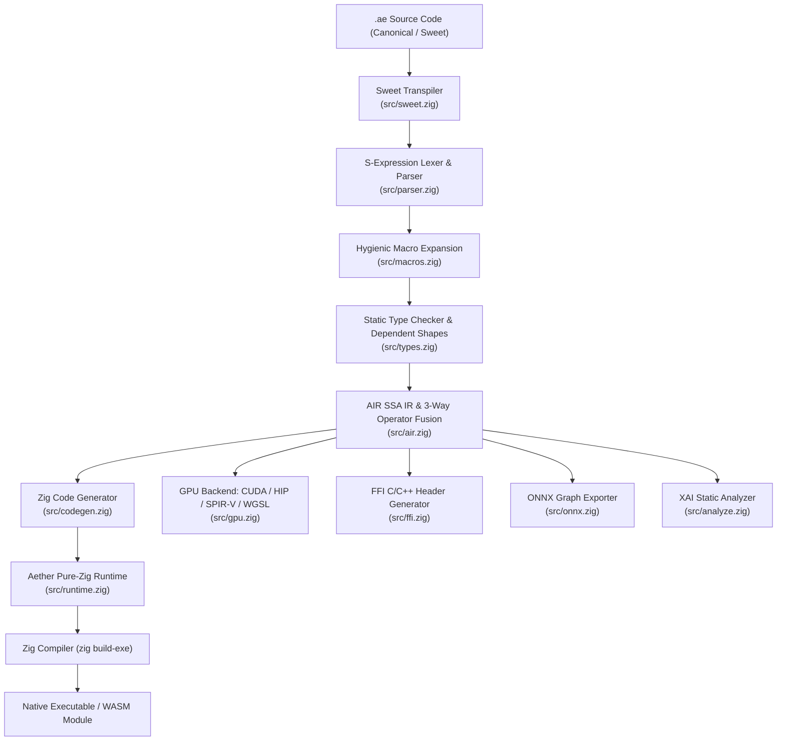

# Aether Programming Language

> **An AI-Native, Homoiconic Programming Language Built from First Principles in Pure Zig.**

Aether is an experimental programming language engineered for high-performance AI computation, differentiable programming, probabilistic modeling, and structured concurrency. Built entirely with **Zig 0.17.0**, the Aether compiler (`aetherc`) generates lean, native code without external C dependencies, LLVM runtime bloat, or garbage collection pauses.

---

## Key Highlights

- **Homoiconic Dual-Syntax**: Seamlessly switch between canonical Lisp-like S-expressions (with cyclic DAG datum labels `#1=`, `#1#`) and human-friendly Sweet indentation syntax.
- **First-Class AI & Tensor Primitives**: Native N-dimensional tensors, matrix multiplication (`matmul`), activations (`relu`, `sigmoid`, `tanh`, `softmax`), loss functions (`mse_loss`, `cross_entropy`), and INT8 model quantization (`quantize`).
- **First-Class Tensor Backpropagation & Optimizers**: Reverse-mode tape recording with exact analytical tensor gradients ($W^T \cdot dY$, $X^T \cdot dY$, activation derivatives), multi-layer loss backpropagation (`backward`, `grad`, `clear_grads`), and built-in optimizers (`sgd_step`, `adam_step`).
- **Static Symbolic Differentiation**: Compile-time symbolic differentiation (`diff`) with algebraic simplification rules.
- **Probabilistic Modeling & Uncertainty Types**: First-class confidence bounds (`10.0 ± 0.2`) with Gaussian error propagation, standard sampling distributions (`Normal`, `Uniform`, `Bernoulli`), and Bayesian likelihood observation (`observe`).
- **Pluggable Memory Management Modes**: Choose between compile-time **Autofree** (default, inspired by V lang static escape analysis), **Scoped Arenas** with deep-copy returns, precise **Tracing Mark-and-Sweep Garbage Collection** across worker threads, and **Manual** memory management with automatic process exit leak detection (`--mem autofree|arena|manual|gc`).
- **Static Shape & Linear Safety**: Dependent tensor shape validation with multidimensional broadcasting ($[M, 1] + [M, N]$), function return type checking, and linear ownership tracking to prevent use-after-free or double-free defects.
- **Dynamic Collections Suite**: Heterogeneous dynamic arrays (`List`), hash maps (`Map`), unique sets (`Set`), and double-ended queues (`Deque`) integrated into `runtime.Value`.
- **Embeddable Scripting Engine**: In-process VM for game scripting and host applications in Zig, C (C99), and C++ (C++11/17/20). Supports evaluating Canonical S-expressions and Sweet syntax, host-to-script function calls, bidirectional global variable access, userdata host callbacks, and zero-overhead opaque pointer (`Value.ptr: ?*anyopaque`) interop.
- **Multi-Vendor GPU Kernel Lowering & CPU Simulator**: Direct emission of NVIDIA CUDA (`.cu`), AMD ROCm/HIP (`.hip`), Vulkan SPIR-V (`.spv`), and WebGPU WGSL (`.wgsl`) compute shaders, plus a transparent multi-threaded CPU fallback simulator.
- **Structured Concurrency & Distributed Computing**: OS worker thread pool (`std.Thread`), data-parallel multicore loops (`@parallel for` / `parallel_for`), and framed binary RPC cluster communication (`cluster_start`, `cluster_spawn`, `cluster_send`, `aetherc node`).
- **AIR SSA IR Pipeline**: Aether Intermediate Representation with 3-way operator fusion (`matmul + bias + relu` $\to$ `fused_dense_relu`), compile-time constant folding, dead-code elimination, IR inspection (`--emit-air`), semantic validation (`--check`), and optimization levels (`-O0` to `-O3`).
- **Expanded Standard Library**: Comprehensive math & trigonometry (`asin`, `acos`, `atan2`, `log2`, `log10`, `clamp`), statistics (`mean`, `variance`, `stddev`), native zero-dependency file I/O (`file_read_str`, `file_write_str`), and string manipulation (`str_split`, `str_join`, `str_trim`, `str_contains`).
- **AI-Native Tooling**: Content-addressed 128-bit DAG hashing, static Explainable AI (XAI) FLOP and memory profiling, ONNX model graph export, zero-cost C/C++ FFI binding generation, and an interactive REPL (`aetherc repl`).

---

## Toolchain & Compiler Architecture

The compiler toolchain is modular, clean, and contained within [`src/`](file:///src/):



| Source File | Description |
|---|---|
| [`build.zig`](file:///build.zig) | Zig build script compiling `aetherc` and orchestrating the test suites. |
| [`src/main.zig`](file:///src/main.zig) | CLI driver for running, building, checking, formatting, hashing, binding, analyzing, exporting, and cluster nodes. |
| [`src/parser.zig`](file:///src/parser.zig) | S-expression & bracket parser supporting datum labels (`#1=`, `#1#`) and cyclic graph ASTs. |
| [`src/types.zig`](file:///src/types.zig) | Gradual type checker, compile-time tensor shape broadcasting, return type validation, and linear ownership verifier. |
| [`src/macros.zig`](file:///src/macros.zig) | Hygienic macro expander supporting compile-time syntax transformations and parameter substitution. |
| [`src/sweet.zig`](file:///src/sweet.zig) | Bidirectional transpiler between human infix/indented syntax and canonical S-expressions. |
| [`src/token_dag.zig`](file:///src/token_dag.zig) | Flat 32-bit tokenized DAG binary encoder and deterministic 128-bit FNV-1a content hash. |
| [`src/autodiff.zig`](file:///src/autodiff.zig) | Whole-graph symbolic differentiation engine with algebraic simplification rules. |
| [`src/runtime.zig`](file:///src/runtime.zig) | Pure-Zig runtime: dynamic `Value`, N-D `Tensor`, reverse-mode autodiff tape, optimizers, collections, stdlib, and builtins. |
| [`src/air.zig`](file:///src/air.zig) | Aether SSA Intermediate Representation (AIR) with 3-way operator fusion (`fused_dense_relu`), constant folding, and DCE. |
| [`src/autofree.zig`](file:///src/autofree.zig) | Static escape analysis pass identifying non-escaping local heap objects for compile-time autofree lowering. |
| [`src/codegen.zig`](file:///src/codegen.zig) | Pure-Zig code generator with lexical closure capture, ADT/pattern match lowering, and kernel fallback loops. |
| [`src/gpu.zig`](file:///src/gpu.zig) | Multi-vendor compute shader backend lowering `(kernel ...)` blocks to CUDA (`.cu`), HIP (`.hip`), SPIR-V (`.spv`), and WGSL (`.wgsl`). |
| [`src/ffi.zig`](file:///src/ffi.zig) | Zero-cost C/C++ header generator and ABI wrapper for external language interoperability. |
| [`src/concurrency.zig`](file:///src/concurrency.zig) | Native OS worker thread pool (`std.Thread`), task queues, spinlocks, and actor message dispatch. |
| [`src/distributed.zig`](file:///src/distributed.zig) | Distributed cluster node, binary 25-byte framed RPC packet protocol, and remote actor routing. |
| [`src/replay.zig`](file:///src/replay.zig) | Deterministic replay runtime with seed-tagged PRNG streams, tick tracking, and state rewinding. |
| [`src/stdlib.zig`](file:///src/stdlib.zig) | Standard libraries for 3D vector mathematics (`Vec3`, `dot`, `cross`, `norm`), physics, and ECS hooks. |
| [`src/runtime_mem.zig`](file:///src/runtime_mem.zig) | Unified thread-safe memory manager: payload tracking, mark-and-sweep tracing GC, scoped arenas, manual frees, and leak reporter. |
| [`src/analyze.zig`](file:///src/analyze.zig) | Static computation graph analyzer reporting tensor allocations, memory footprint, FLOPs, and XAI traces. |
| [`src/onnx.zig`](file:///src/onnx.zig) | Standard ONNX JSON and binary Protobuf model graph exporter and weight parser. |
| [`src/lsp.zig`](file:///src/lsp.zig) | JSON-RPC 2.0 Language Server Protocol daemon supporting hover, autocomplete, and diagnostics. |
| [`src/repl.zig`](file:///src/repl.zig) | Interactive Read-Eval-Print Loop (REPL) and runtime evaluator supporting multi-statement evaluation, collections, control flow, and user functions. |
| [`src/embed.zig`](file:///src/embed.zig) | In-process embeddable VM (`aether.VM`) and C ABI export (`ae_*`) for Zig, C, and C++ game scripting. |
| [`include/aether.h`](file:///include/aether.h) | Single-header C99 / C++ API with inline constructors and C++ `aether::VM` RAII wrapper. |

---

## Quickstart & CLI Reference

### 1. Prerequisites & Build
Requires [Zig 0.17.0+](https://ziglang.org/). Zero external dependencies.

```bash
# Clone and build the Aether compiler, C libraries, and header
zig build

# Verify installation with all unit and C integration tests
zig build test --summary all
```

Build outputs installed to `zig-out/`:
- `zig-out/bin/aetherc.exe`: Standalone compiler & CLI driver.
- `zig-out/lib/aether.lib`: C-compatible static library (`libaether`).
- `zig-out/bin/aether.dll`: C-compatible shared library.
- `zig-out/include/aether.h`: Single-header C99 / C++ API with inline C++ RAII wrapper.

### 2. Command-Line Reference

```bash
# 1. Type & Semantic Verification (exits 0 if valid, no binary emitted)
aetherc check <file.ae>

# 2. Execute an Aether script directly (default: --mem autofree)
aetherc run <file.ae> -O2
aetherc run <file.ae> --mem autofree
aetherc run <file.ae> --mem arena
aetherc run <file.ae> --mem manual
aetherc run <file.ae> --mem gc

# 3. Compile to a standalone native executable with selected memory mode
aetherc build <file.ae> --mem autofree -o my_app.exe
aetherc build <file.ae> -o my_app.exe

# 4. Compile a stripped production release executable without a console window
aetherc build <file.ae> --release -o my_app.exe
aetherc build <file.ae> --release --console -o debug_app.exe
aetherc build <file.ae> --no-console -o gui_app.exe

# 5. Emit human-readable SSA Intermediate Representation (AIR)
aetherc build <file.ae> --emit-air -o my_app.air

# 5. Emit GPU Compute Kernels (NVIDIA CUDA, AMD ROCm/HIP, Vulkan SPIR-V, WebGPU WGSL)
aetherc build --target cuda <file.ae> -o kernel.cu
aetherc build --target hip <file.ae> -o kernel.hip
aetherc build --target spirv <file.ae> -o kernel.spv
aetherc build --target gpu <file.ae> -o kernel.wgsl

# 6. Compile to WebAssembly (WASI)
aetherc build --target wasm32 <file.ae> -o my_app.wasm

# 7. Start a distributed cluster worker node
aetherc node --port 9000

# 8. Inspect the generated Zig intermediate source
aetherc build <file.ae> --emit-zig -o generated.zig

# 9. Format / transpile between Canonical and Sweet syntax
aetherc fmt --to-canonical <file.ae>
aetherc fmt --to-sweet <file.ae>

# 10. Compute the deterministic 128-bit DAG content hash
aetherc hash <file.ae>

# 11. Generate C/C++ FFI header bindings
aetherc bind --language c <file.ae>

# 12. Perform Explainable AI (XAI) static analysis
aetherc analyze <file.ae>

# 13. Export computation graph to ONNX JSON or binary Protobuf
aetherc export <file.ae>

# 14. Start the Language Server Protocol (LSP) daemon
aetherc lsp

# 15. Manage content-addressed package registry
aetherc pkg publish <file.ae>
aetherc pkg fetch "#0x<hash>"
aetherc pkg list

# 16. Start the interactive REPL
aetherc repl
```

---

## Pluggable Memory Management Modes

Aether provides four first-class memory management strategies via `--mem <mode>`, tailored for different workload requirements:

| Mode | Flag | Description | Best For |
|---|---|---|---|
| **Autofree** *(Default)* | `--mem autofree` | Compile-time static escape analysis (inspired by V lang). Local allocations that do not escape their function scope are automatically freed at scope exit via injected `defer autoFree`. Zero runtime GC pauses. | General applications, scripts, CLI tools, predictable low latency. |
| **Arena** | `--mem arena` | Region-based memory. Program-wide arena allocation or nested `(arena ...)` lexical blocks. Values returned from an `(arena ...)` block are automatically deep-copied to the outer arena while internal temporary allocations are reclaimed. | Batch workloads, compilers, parsers, per-frame game loops. |
| **Manual** | `--mem manual` | Explicit developer-controlled deallocation via `(free x)`. Double-free safe. On program exit, any surviving allocations are counted and reported to `stderr`: `aether (manual memory): N allocations (B bytes) still live at exit`. | Systems programming, embedded targets, strict zero-overhead tracking. |
| **Tracing GC** | `--mem gc` | Multi-threaded mark-and-sweep tracing garbage collector. Tracks roots via thread-local shadow stacks (`gcRoot`/`gcUnroot`) and handles scope pins (`gcPin`). Traverses live objects across worker threads and automatically protects autodiff tape nodes. Manual collection triggerable via `(gc_collect)`. | Long-running servers, dynamic graphs, cyclical object structures. |

### Memory Builtin Functions

- `(free x)`: Explicitly frees a heap-allocated dynamic object (tensor, list, map, set, deque, string). Safe against double-free.
- `(mem_live)`: Returns the current number of tracked live heap allocations across the process.
- `(gc_collect)`: In `--mem gc` mode, forces an immediate mark-and-sweep garbage collection cycle.

### Scoped Arena Blocks

Expressions or statement blocks can be wrapped in `(arena ...)`:
```lisp
(let summary
  (arena
    (let intermediate (list 1 2 3 4 5))
    (let doubled (map intermediate (lambda (x) (* x 2))))
    doubled)) # 'doubled' is deep-copied to outer scope; 'intermediate' is freed immediately
```
*Safety Note*: Mutating outer variables via `set` or calling `return` from inside an `(arena ...)` block is statically rejected by the compiler (`CodegenError.ArenaEscape`) to prevent dangling pointers.

---

## Embeddable Scripting (Zig / C / C++)

Aether includes an in-process VM and unified runtime evaluator for embedding Aether scripts inside game engines, simulations, and host tools.

### Capabilities
- **Dual Syntax**: In-process evaluation of both canonical S-expressions and Sweet syntax.
- **Host Callbacks**: Register native functions with arbitrary userdata (`void*` / `*anyopaque`).
- **Bidirectional Interop**: Call script functions from host code and inspect/mutate global variables.
- **Opaque Pointers**: Wrap native game entities (`Value.ptr: ?*anyopaque`) with zero boxing overhead.
- **Clean Packaging**: Public Zig module `"aether"`, C static library `aether.lib`, C shared library `aether.dll`, and single header `aether.h`.

### Zig Integration Example

```zig
const std = @import("std");
const aether = @import("aether");

pub fn main() !void {
    var gpa = std.heap.GeneralPurposeAllocator(.{}){};
    defer _ = gpa.deinit();

    var vm = aether.VM.init(gpa.allocator());
    defer vm.deinit();

    // Register a native callback
    const Host = struct {
        fn logMsg(args: []const aether.Value, udata: ?*anyopaque) aether.Value {
            _ = udata;
            if (args.len > 0 and args[0] == .string) {
                std.debug.print("Host Log: {s}\n", .{args[0].string});
            }
            return .nil;
        }
    };
    try vm.registerFn("log", Host.logMsg, null);

    // Evaluate Sweet syntax
    _ = try vm.eval(
        \\fn on_damage(amount) {
        \\    log("Player took damage!")
        \\    amount * 2
        \\}
    );

    // Call script function from Zig host
    var args = [_]aether.Value{ aether.Value.int(15) };
    const res = try vm.call("on_damage", &args);
    std.debug.print("Damage calculation: {}\n", .{res.integer});
}
```

### C Integration Example (C99)

```c
#include <stdio.h>
#include <aether.h>

static AeValue native_heal(const AeValue* args, uint32_t count, void* userdata) {
    int* hp = (int*)userdata;
    if (count > 0 && args[0].type == AE_TYPE_INT) {
        *hp += (int)args[0].data.i;
    }
    return ae_int(*hp);
}

int main(void) {
    ae_vm* vm = ae_vm_create();
    int player_hp = 50;

    ae_register_fn(vm, "heal", native_heal, &player_hp);
    ae_eval(vm, "heal(25)", NULL);

    printf("Player HP: %d\n", player_hp); // 75
    ae_vm_destroy(vm);
    return 0;
}
```

### C++ Integration Example (C++17)

```cpp
#include <iostream>
#include <aether.h>

int main() {
    aether::VM vm;
    int score = 0;

    vm.registerFunction("add_score", [&](const AeValue* args, uint32_t count) {
        if (count > 0 && args[0].type == AE_TYPE_INT) {
            score += static_cast<int>(args[0].data.i);
        }
        return ae_int(score);
    });

    vm.eval("add_score(100)");
    std::cout << "Score: " << score << "\n"; // 100
    return 0;
}
```

---

## Real-World Applications

Eighteen complete applications are included in the [`apps/`](file:///apps/) directory:

1. **`apps/aether_blocks.ae`**: Complete standalone falling-block arcade puzzler with real-time multi-channel audio mixer, chiptune soundtrack loop, polyphonic SFX, 7-bag randomizer, full SRS 5-test kick tables, 3-corner T-spin detection, ghost piece, hold piece, and high score persistence.
2. **`apps/aether_invaders.ae`**: Retro arcade space shooter built on the Aether engine with player controls, sprite collisions, projectile pools, particle bursts, and procedural sound generation.
3. **`apps/neural_classifier.ae`**: Multi-layer neural network with tensor forward inference, activations (`relu`, `sigmoid`), MSE loss, analytical tape backpropagation (`backward`), parameter updates, and INT8 quantization.
4. **`apps/physics_sim.ae`**: 2D orbital mechanics simulation with gravitational acceleration, Euler-Cromer numerical integration, and total mechanical energy conservation tracking.
5. **`apps/sensor_fusion.ae`**: Autonomous vehicle state estimation combining noisy LiDAR and Radar sensor streams via optimal inverse-variance Kalman weighting and Gaussian uncertainty arithmetic.
6. **`apps/expert_diagnostics.ae`**: Cloud cluster telemetry classifier with multi-branch pattern matching (`match`), incident triage rule engines, and automated mitigation dispatch.
7. **`apps/visual_orbital_sim.ae`**: Real-time gravitational body visualization using the built-in software framebuffer rasterizer and BMP export.
8. **`apps/tic_tac_toe.ae`**: Interactive two-player game engine with turn state validation, minimax AI, win condition evaluation, board resets, and replay logging.
9. **`apps/neon_serpent.ae`**: Cyberpunk snake with online autodiff neural opponent, glow trails, particle sparks, and adaptive speed scaling.
10. **`apps/gravity_well.ae`**: Interactive N-body orbital physics simulator with particle trails, inelastic collision coalescence, and energy conservation readouts.
11. **`apps/deep_crypt.ae`**: Roguelike dungeon crawler with procedural generation, raycast FOV visibility, turn-based combat, and inventory.
12. **`apps/aether_8.ae`**: Retro 16-color fantasy console cartridge runtime with 128x128 VRAM display, sprite blitter, sound synth, and cartridge loader.
13. **`apps/aether_tracker.ae`**: 8-channel chiptune music tracker with pattern editor, ADSR instrument envelopes, MIDI-to-Hz tuning, and audio playback.
14. **`apps/pixel_forge.ae`**: 2D pixel-art sprite animator and tilemap editor with onion skinning color blending and canvas stamp brushes.
15. **`apps/aether_notebook.ae`**: Computational notebook with reactive execution cells, markdown rendering, and inline sparkline tensor plots.
16. **`apps/aether_infer.ae`**: Local neural model inference runner with INT8 dequantization, greedy argmax logit sampling, and streaming token throughput benchmarks.
17. **`apps/quill.ae`**: Minimalist markdown text processor and static documentation site generator with live preview and semantic HTML export.
18. **`apps/aether_sound_lab.ae`**: Modular DSP synthesizer rack with patchable oscillators, 1-pole resonant lowpass filter, LFO frequency modulation, and spectrum response visualization.

To run any application:
```bash
aetherc run apps/<app_name>.ae
```

---

## Testing & Quality Assurance

Aether includes 26 comprehensive test suites spanning compiler unit tests, runtime memory modes, language features, and native C embedding integration:

```bash
# Run all compiler unit tests, embed tests, and execute the C embedding test suite
zig build test --summary all

# Run integration test suites
aetherc run tests/test_mem_autofree.ae --mem autofree # Static escape analysis and scope deallocation
aetherc run tests/test_mem_arena.ae --mem arena       # Scoped arena blocks and deep-copy return extraction
aetherc run tests/test_mem_manual.ae --mem manual     # Explicit free, double-free safety, and leak reporting
aetherc run tests/test_mem_gc.ae --mem gc             # Mark-and-sweep GC, root tracking, and tape protection
aetherc run tests/test_air.ae              # SSA IR, 3-way fusion (dense_relu), constant folding
aetherc run tests/test_stdlib.ae           # Math, statistics, string utils, native file I/O
aetherc run tests/test_collections.ae      # List, Map, Set, Deque operations
aetherc run tests/test_tensor_autodiff.ae  # Reverse-mode tape backpropagation, SGD optimizer
aetherc run tests/test_gpu.ae              # GPU kernel emission and CPU fallback simulator
aetherc run tests/test_concurrency.ae      # Multi-actor message passing and state updates
aetherc run tests/test_distributed.ae      # @parallel for loop and cluster binary RPC
aetherc run tests/test_engine.ae           # Physics AABB/circle overlap, GUI buttons, sliders
aetherc run tests/test_audio.ae            # Procedural synthesizer, WAV and QOA export
aetherc run tests/test_graphics.ae         # Framebuffer lines, circles, BMP export
aetherc run tests/test_tui.ae              # Half-block ANSI terminal canvas and sparkline
aetherc run tests/test_tictactoe.ae        # Turn-based engine simulation
aetherc run tests/test_compilation.ae      # Base functions and calls
aetherc run tests/test_simple.ae           # Basic arithmetic evaluation
aetherc run tests/test_match.ae            # Algebraic pattern matching
aetherc run tests/test_macro.ae            # Compile-time hygienic macro expansion
aetherc run tests/test_static_diff.ae      # Static symbolic differentiation (diff)
aetherc run tests/test_nn.ae               # Neural network layers, loss, quantization
aetherc run tests/test_prob.ae             # Uncertainty arithmetic (val ± err) and Normal sampling
aetherc run tests/test_replay.ae           # PRNG seed recording and state rewinding
aetherc run tests/test_sweet.ae            # Sweet indentation syntax parsing
# Embedded C integration test suite (compiled & executed automatically during zig build test):
# tests/test_embed_c.c -> zig-out/bin/test_embed_c
```

---

## Current Scope Boundaries & Non-Implemented Features

To remain pure-Zig, dependency-free, and maintainable, Aether deliberately draws boundaries around certain systems. The following features are **not implemented** in this version:

1. **Direct In-Process Vendor GPU Kernel Launches (`cuLaunchKernel` / `hipModuleLaunchKernel`)**:
   - *Current Implementation*: Aether generates clean, standalone source kernels for NVIDIA CUDA (`.cu`), AMD ROCm/HIP (`.hip`), Vulkan SPIR-V (`.spv`), and WebGPU WGSL (`.wgsl`), dynamically probes driver presence via `GpuDriverRuntime`, and executes out-of-the-box via its pure-Zig multi-threaded CPU fallback simulator.
   - *Not Implemented*: Directly linking vendor SDK runtime libraries and executing physical GPU device kernel launches (`cuLaunchKernel`) in-process.

2. **Generational Moving Garbage Collection & Compacting**:
   - *Current Implementation*: Aether supports four memory strategies (`autofree`, `arena`, `manual`, and a non-moving mark-and-sweep `gc` with thread-local shadow stacks and root tracking).
   - *Not Implemented*: Generational moving/compacting collectors with read/write barriers. Pointers remain stable for their entire lifetime.

3. **In-Process Machine Code JIT Compilation**:
   - *Current Implementation*: Ahead-of-Time (AOT) compilation via `aetherc build` and `aetherc run` (which compiles and executes an ephemeral native binary via Zig), plus an AST interpreter in `aetherc repl`.
   - *Not Implemented*: In-process machine code generation emitting dynamic x86_64/ARM64 opcodes at runtime. Direct native machine code backend is preserved in `archive/aetherv4_native/`.

4. **Direct Wayland / Cocoa Desktop Windowing (Linux / macOS)**:
   - *Current Implementation*: Desktop windowing provides native Win32 windowing with GDI and OpenGL hardware swapchain (`use_hardware_swapchain`), Linux X11 display detection (`X11Probe`), and cross-platform 24-bit TrueColor ANSI terminal TUI fallback.
   - *Not Implemented*: Direct Wayland protocol client libraries or macOS Cocoa/AppKit window bindings.

5. **Cross-Platform Native Audio Streaming (macOS CoreAudio / Linux ALSA)**:
   - *Current Implementation*: Zero-dependency Windows WinMM (`waveOutOpen` / `waveOutWrite`) multi-voice audio streaming thread with stereo panning and spatial attenuation; non-Windows platforms synthesize audio to files (WAV, QOA).
   - *Not Implemented*: Native real-time streaming audio threads on Linux (ALSA/PulseAudio) or macOS (CoreAudio).

6. **Arbitrary Dynamic Lifetime Escaping Closures**:
   - *Current Implementation*: Lexical closure capture is fully supported for local scopes, `@parallel for`, and actors.
   - *Not Implemented*: Returning closures that outlive their defining stack frames across arbitrary untracked thread boundaries without an enclosing arena or linear lifetime token.

---

## License

Aether is released under the MIT License. See [LICENSE](file:///LICENSE) for details.
